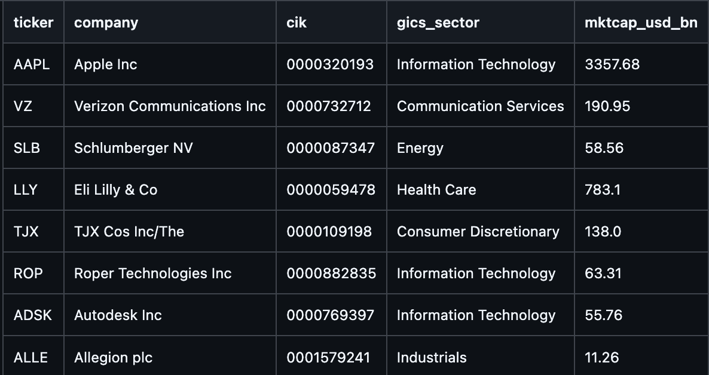
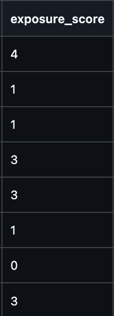
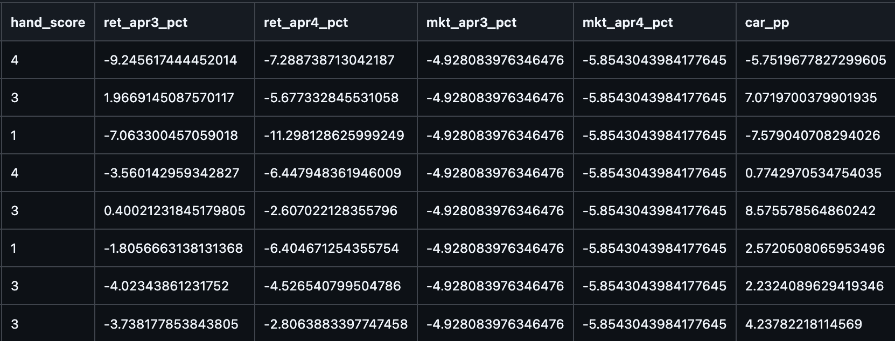
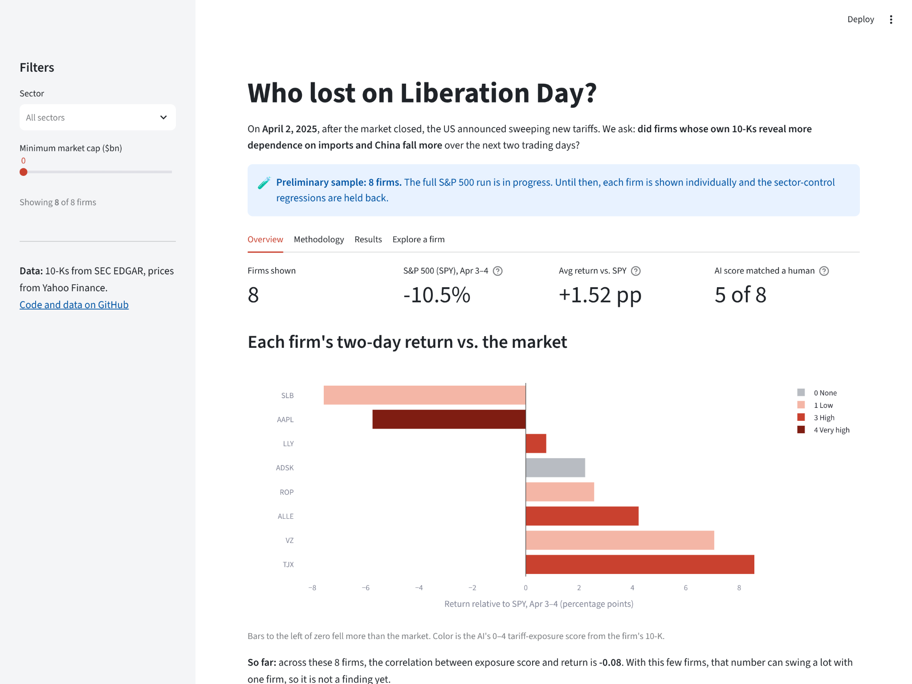
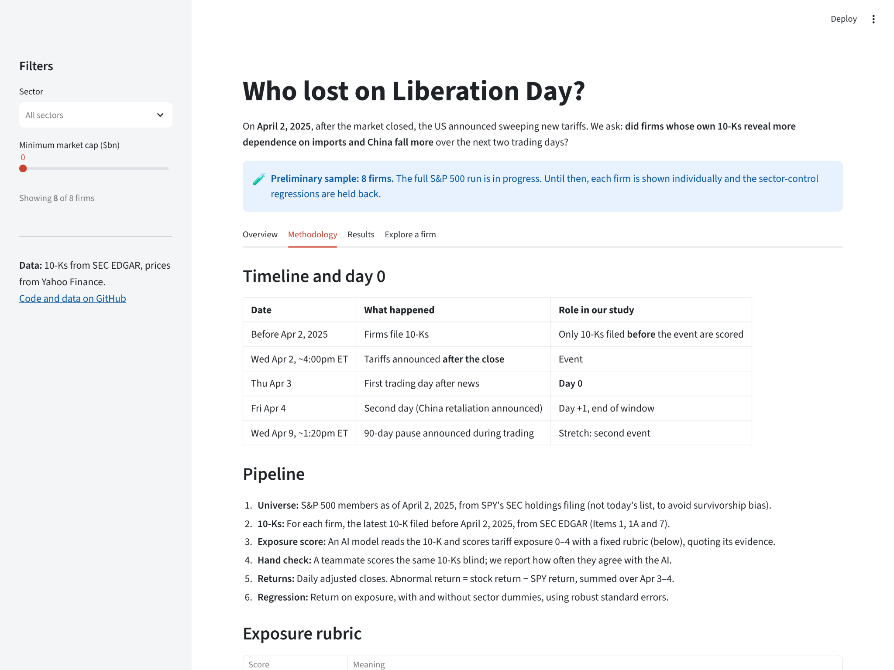
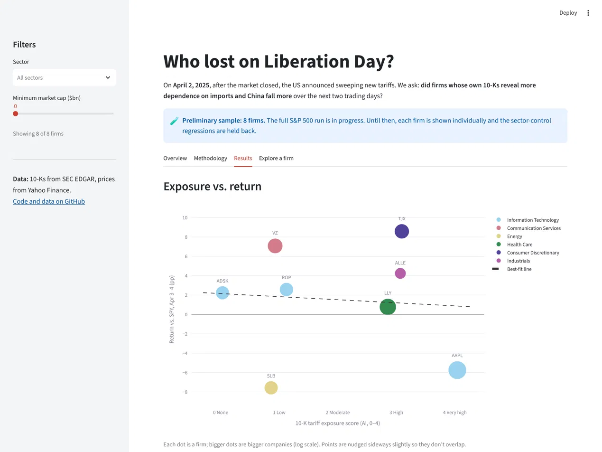
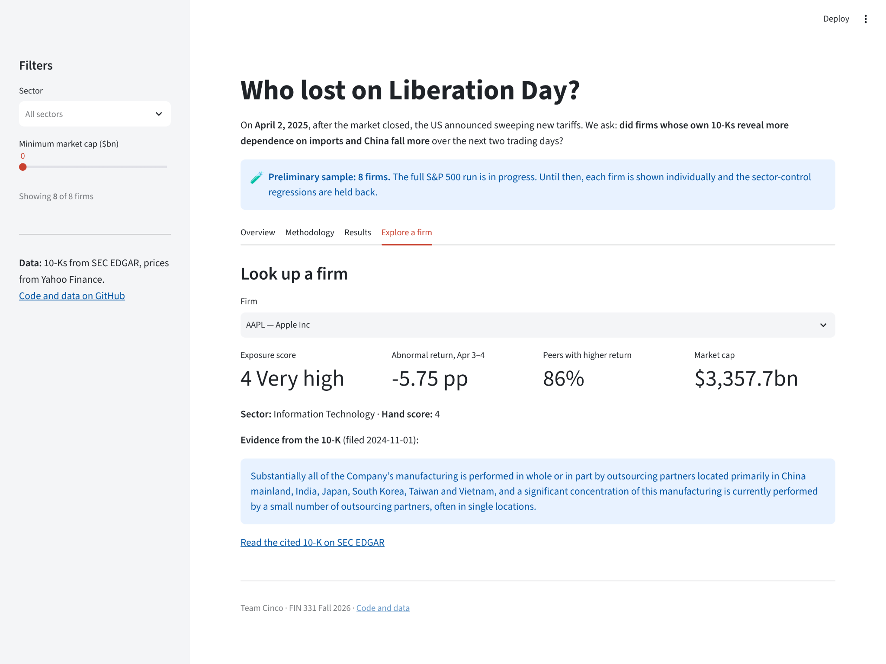

# Team Cinco Proposal: Who lost on Liberation Day

Charlie Grippo, Gunnar Krein, Carter Loi

## 1. The Question

On April 2, 2025, President Donald Trump announced a large tariff on imports, later called “Liberation Day.” This event significantly hurt the overall market in the two days following. We wanted to understand why certain companies got hit worse by the tariffs and if there were predictive variables that would have allowed investors and executives to see the risk before it happened. Our general question for that is:

> Could losing companies on Liberation Day be predicted beforehand based on their dependency on imports, overseas manufacturing, and overall structure?

Our target market would be investors, who would use this to spot which stocks are at the highest risk before the next tariff announcement. Additionally, company higher-ups like CFO/CEO’s could use it to identify how exposed their company is in comparison to other companies in its market.

## 2. The Data

### Unit of Observation

One row of our dataset is a firm that was in the S&P 500 on April 2, 2025. To get that data, we used SPY which is an ETF that has every stock in the S&P 500. This is because there isn’t a free official list of past S&P 500 companies at any point in time, but SPY reports its holdings to the SEC so we can pull the companies from that. The key of the dataset is ticker.

We added a few columns that gave us information like the industry, market cap, 10-K filing date, and returns for the firm and SPY. Most of the variables were necessary to run the analysis, but we included some (such as hand score and car_mm) that acted as checks or to better understand the output. Below are some examples from our v0 run:

### Sample Period & Conditions

We pulled data for the firms from their 10-K before the announcement on April 2. Since different firms file at different times, the dates of the 10-K fall between February 26, 2024 and April 1, 2025.

The SPY holdings on March 31 contained 503 securities and 431 could be scored. Some of the firms failed, did not fit our guidelines, or needed to be removed. This includes:

- Different classes of common stock for the same firm

- Different layouts of the 10-K that were not considered “standard”

- Text in the 10-K that exceeded our 350,000 character limit

Our v0 ran with 5 hand picked firms (Apple, Verizon, Nike, SLB, and Hess) and 5 firms drawn at random (Roper, TJX, Autodesk, Allegion, and Eli Lilly). Those 10 were tried and 8 completed. Nike failed because the model’s quote wasn’t an exact match to the filing. Hess also failed because it had no prices after Chevron bought it.

### Raw Inputs

| Input | Source | How to get it | Where it lives |
|----|----|----|----|
| S&P 500 Members | SPY Form N-PORT (SEC EDGAR) | build_universe.py | raw data/raw/universe/ (not in git); data/universe/universe_2025-04-02.csv |
| Company CIK | SEC ticker file and EDGAR company names | build_universe.py | data/universe/cik_overrides.csv (25 hand fixes) |
| Tickers | OpenFIGI CUSIP lookup and 10-K cover | build_universe.py, build_manifest.py | data/raw/universe/openfigi_responses.json |
| 10-K Filings | SEC EDGAR | fetch_10k_text.py | raw data/raw/tenk/; text data/universe/text/ (rebuilt, not in git) |
| GICS Sectors | 11 Select Sector SPDR N-PORTs | build_manifest.py | data/raw/universe/sector/ |
| Prices | Yahoo Finance | tariff_batch.py | data/raw/tariff_batch/prices/ (in git) |
| Exposure Scores | gpt-4.1-mini | tariff_batch.py | data/raw/tariff_batch/scores/ (in git) |

## 3. The Method

Our overall goal was to figure out each firm's dependence on imports or manufacturing overseas. We used gpt-4.1-mini for the analysis and scoring. Some inputs we gave it included their business/industry, risk factors, management discussion, and analysis. The output was a score from 0-4 that represented exposure to manufacturing in and importing from China

The second part of the analysis was figuring out the impact of Liberation Day through returns. April 3rd was our day 0 since the announcement happened after the market closed on April 2nd. This was done by taking the stocks daily return relative to the SPY on day 0 and 1 (April 3rd and April 4th) and then adding the differences to get CAR. Regression was then used to see how an exposure point is related to the return over the two days.

In v0 8 of the 10 test firms had both a valid score and usable prices. The estimated slope was −0.32 percentage points per exposure point, with a standard error of 2.00. That uncertainty is too large to draw a conclusion about the relationship.

## 4. Threats & Checks

After reviewing our process and viewing the results, we thought of some potential issues with the process. Some of them include:

- Look ahead bias

- Survivorship bias and missing data

- Mismatched companies, filings, and returns

- Overlapping news

To rectify these, we took certain steps to ensure the entire process was clean and free of potential biases. We checked so each 10-K was filed before April 2nd, 2025. This keeps the disclosures filed after the event date out of our model. Using the historical holding and the retained companies acquired after the event date, this allowed for our sample to not have only firms that still exist today. For the mismatched companies, filings, and returns, we made sure to check the SEC company identifiers, filing numbers, and the stock symbols. This made sure that we had the correct exposure score paired with its own filings and returns. For overlapping news, we found that China’s retaliation on April 4th occurred during our two day return window, so just comparing April 3rd alone with the full window would show us how much the second day actually affected our results. This check will show us the influence of any other additional news.

## 5. Dashboard Mockup

### Tab: Overview

The overview tab shows 4 headline numbers, including number of firms in the sample, S&P return (Apr 3-4), Avg return vs. SPY, and the AI score matched by a human. This is useful as it shows the whole story at a glance, who did worse than the market and how exposed they were.

### Tab: Methodology

The methodology tab shows how our system works and why it can be trusted. The tab includes explanations around why April 3 is day 0, the six pipeline steps, the 0-4 rubric our team used, the hand-check process, as well as the threats to validity.

### Tab: Results

The results tab shows whether or not more exposed companies performed worse, and if they did, the dots would slope down to the right. On the page, it shows a chart with one dot per company, with the exposure score running horizontally and return vs the market going vertically.

### Tab: Explore a Firm

The explore a firm tab is, in our opinion, the most useful and interesting piece of our project. This allows anyone to check a company's score for themselves. The page shows a dropdown that allows users to select a firm, and see how it did. In the return, it shows exposure score, abnormal return (April 3-4), peers with higher return, which is the percentage of other companies within the same sample who did better, and the market cap of the company.
