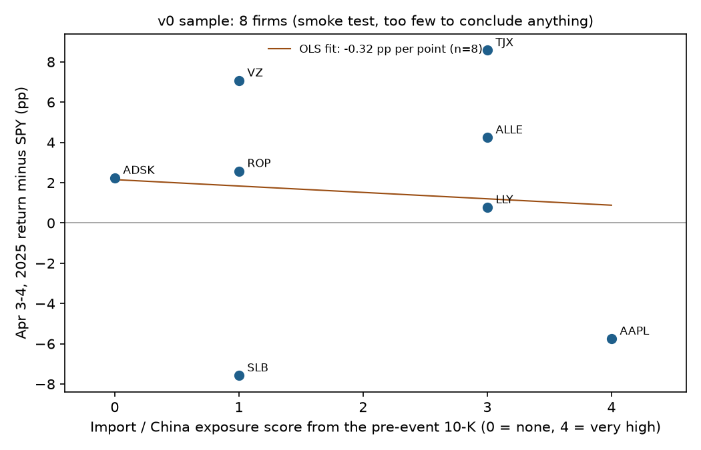

# Who lost on Liberation Day?

**Live dashboard: [team-cinco-liberation-day.streamlit.app](https://team-cinco-liberation-day.streamlit.app/)**

Team Cinco · FIN 331 · Carter Loi, Charlie Grippo, Gunnar Krein · Checkpoint 2 (v0)

Did S&P 500 firms whose pre-event 10-Ks described more dependence on imports, overseas
manufacturing or China fall more relative to the market after the U.S. tariff
announcement on April 2, 2025? Each firm gets a 0–4 exposure score from its own 10-K
(filed before the event) and a two-day market-adjusted return (April 3 + April 4, versus SPY).

## Where things stand

v0 runs every step end to end on a 10-firm sample: the 3 Checkpoint 1 pilot firms, 2 energy
firms, and 5 firms drawn at random with a fixed seed. 8 firms are complete; Nike's AI quote
failed the exact-quote check and Hess has no prices after its acquisition by Chevron
([failures](outputs/batch_v0/failures.csv)). The full ~470-firm run is the next checkpoint.

| Firm | AI exposure (0–4) | Blind hand score | Apr 3–4 return minus SPY |
|---|---:|---:|---:|
| Apple (AAPL) | 4 | 4 | −5.75 pp |
| Allegion (ALLE) | 3 | 3 | +4.24 pp |
| Eli Lilly (LLY) | 3 | 4 | +0.77 pp |
| TJX (TJX) | 3 | 3 | +8.58 pp |
| Roper (ROP) | 1 | 1 | +2.57 pp |
| SLB (SLB) | 1 | 1 | −7.58 pp |
| Verizon (VZ) | 1 | 3 | +7.07 pp |
| Autodesk (ADSK) | 0 | 3 | +2.23 pp |

Eight firms cannot answer the question: the v0 slope is −0.32 pp per exposure point
(p = 0.87). v0 shows the pipeline works. Evidence quotes for every score:
[outputs/v0_firms.md](outputs/v0_firms.md) · AI vs hand check:
[outputs/v0_hand_check.md](outputs/v0_hand_check.md) · Chart:
[outputs/v0_exposure_vs_car.png](outputs/v0_exposure_vs_car.png)



## How to run it

Python 3.10 or later (GitHub's check uses 3.12). From the repository root:

```bash
python -m pip install -r requirements.txt
```

**Quick check (about a minute, no downloads).** Rebuilds the v0 outputs from the saved
results and confirms the dashboard shows them:

```bash
python -m unittest discover -s tests
python scripts/make_outputs.py
python scripts/verify_dashboard.py
```

**Full rebuild from raw SEC data.** One command runs all six steps below:

```bash
export SEC_USER_AGENT="Your Name your.email@school.edu"
python run_all.py
```

The SEC asks every automated request to name a contact, hence `SEC_USER_AGENT`. The first
run downloads about 2.2 GB of filings (roughly 1,000 requests, kept under the SEC's
10-per-second limit); everything is cached under `data/raw/`, so later runs make no
requests. Scoring reads saved model answers from `data/raw/tariff_batch/` (in git), so the
full rebuild needs no API key and costs nothing. `python run_all.py --live` also scores
firms without a saved answer; that needs `pip install edsl` (Python 3.10–3.13) and an
`EXPECTED_PARROT_API_KEY`, and it uses Expected Parrot credits.

**Dashboard locally:** `streamlit run dashboard/app.py`

Every pull request runs the same checks on a clean Linux machine
([workflow](.github/workflows/pilot-audit.yml)): unit tests, the Checkpoint 1 pilot rebuilt
byte for byte, the v0 outputs rebuilt byte for byte, and the dashboard check.

## The pipeline

| Step | Script | What it does | Writes |
|---|---|---|---|
| 1 | [`build_universe.py`](scripts/build_universe.py) | S&P 500 on 2025-04-02 from SPY's SEC Form N-PORT holdings for 2025-03-31; CIK for each firm, checked against EDGAR names | `data/universe/universe_2025-04-02.csv` |
| 2 | [`fetch_10k_text.py`](scripts/fetch_10k_text.py) | Last original 10-K filed before 2025-04-02; Items 1, 1A and 7 as plain text | `data/universe/text/`, `data/universe/tenk_filings.csv` |
| 3 | [`build_manifest.py`](scripts/build_manifest.py) | Ticker from the 10-K cover, GICS sector from the SPDR sector funds, market cap; v0 sample | `data/universe/manifest.csv` |
| 4 | [`validate_manifest.py`](scripts/validate_manifest.py) | Rechecks every manifest fact against EDGAR; stops on any problem | (checks only) |
| 5 | [`tariff_batch.py`](scripts/tariff_batch.py) | 0–4 exposure score from the 10-K text with an exact supporting quote (gpt-4.1-mini via Expected Parrot); April 2–4 prices; returns | `outputs/batch_v0/` |
| 6 | [`make_outputs.py`](scripts/make_outputs.py) | Joins the blind hand scores, writes the dashboard data, firm table, regression and chart | `data/processed/tariff_firms.csv`, `outputs/v0_*` |

The outcome is `car_pp` = (stock − SPY return on April 3) + (stock − SPY return on April 4),
in percentage points, with the April 2 close as the base. Column definitions:
[docs/DATA_CONTRACT.md](docs/DATA_CONTRACT.md). Scoring details:
[docs/CARTER_PIPELINE.md](docs/CARTER_PIPELINE.md).

## Threats to validity

- **The model may already know what happened.** gpt-4.1-mini's training data reportedly
  ends in mid-2024, before the event, and it sees only the filing text with an instruction
  not to use outside knowledge. A second pass with company names hidden is planned; if
  scores barely change, leakage is not driving them.
- **The score is a judgment.** On v0, a teammate's blind scores matched the AI exactly for
  5 of 8 firms and within one point for 6 of 8. The two large gaps (Autodesk, Verizon) come
  from the 0–4 scale mixing import costs with foreign sales; any rewording has to be fixed
  and logged before the full-sample regression. Three of the hand-checked firms (Apple,
  Nike, Verizon) had pilot scores already in this README, so their check was not fully blind.
- **Missing firms are not random.** 30 of 500 firms have no extracted 10-K text yet (mostly
  banks and utilities, but also Deere, Intel, GE and Honeywell), and 39 texts exceed the
  scorer's 350,000-character limit. Firms acquired after April 2025 (e.g. Hess) have no
  Yahoo prices. The full run will report results with and without these groups.
- **Other news inside the window.** China announced retaliatory tariffs on April 4, the
  second day of our window. We will also report April 3 on its own.
- **Beta = 1.** Subtracting SPY assumes every stock moves one-for-one with the market. A
  market-model (beta-adjusted) return is planned.
- **Market cap.** Shares come from the 10-K cover, which can be up to a year old by
  March 31, 2025.
- **How many things we tried.** Every choice that could change results is logged in
  [specs_tried.md](specs_tried.md), including rejected ones. The v0 regression was run once.

Open issues and their fixes: [audits/01_self_audit.md](audits/01_self_audit.md).

## What's where

```text
run_all.py              one command: steps 1-6
scripts/                the pipeline scripts and checks (verify_dashboard.py, verify_tariff_pilot.py)
data/universe/          universe, 10-K log, manifest, v0 sample, CIK fixes, section markers
data/raw/               downloads (git-ignored), except tariff_batch/: saved model answers and prices
data/processed/         tariff_firms.csv, the dataset the dashboard reads
data/pilot/             Checkpoint 1 three-firm pilot (still rebuilds: scripts/tariff_pilot.py)
data/toy/               labeled fake data for dashboard development
outputs/                v0 results: firm table, hand check, regression, chart, batch run logs
dashboard/              Streamlit app (dashboard/README.md)
audits/                 self-audit and the blind hand-check
docs/                   data contract, scoring pipeline, v0 fact sheet
tests/                  unit tests for the scorer
specs_tried.md          every specification choice, including rejected ones
STATUS.md               Checkpoint 1 memo
```

## Team

- **Carter Loi:** scoring and returns pipeline (`tariff_batch.py`), hand check, CI checks
- **Charlie Grippo:** universe, 10-K text, manifest, `run_all.py`
- **Gunnar Krein:** dashboard, data contract, self-audit
