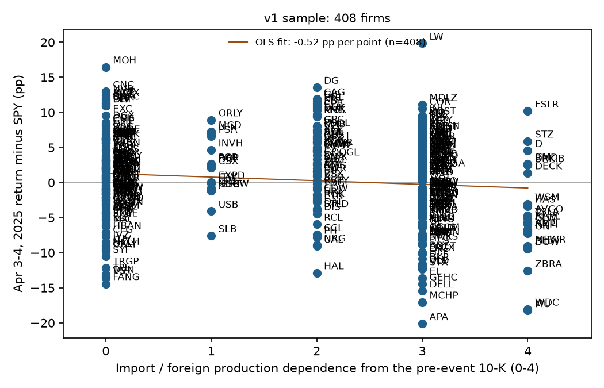

# Who lost on Liberation Day?

**Live dashboard: [team-cinco-liberation-day.streamlit.app](https://team-cinco-liberation-day.streamlit.app/)**

Team Cinco · FIN 331 · Carter Loi, Charlie Grippo, Gunnar Krein · Checkpoint 3 (v1)

Did S&P 500 firms whose pre-event 10-Ks described more dependence on imports and overseas
manufacturing fall more relative to the market after the U.S. tariff announcement on
April 2, 2025? Each firm gets a 0–4 exposure score from its own 10-K (filed before the
event) and a two-day market-adjusted return (April 3 + April 4, versus SPY). SPY itself
fell 10.5% over those two days.

## Results (v1, full sample)

**Sample.** All 500 S&P 500 members on April 2, 2025 were attempted; **408 are complete**
(a score with an exact 10-K quote, and prices). Missing: 46 filings over the scorer's
350,000-character limit (excluded, never cut), 27 whose quote was not in the filing, 3 the
model could not score, and 16 with no prices, mostly firms acquired after the event
([failures](outputs/batch_v1/failures.csv),
[coverage by sector](outputs/batch_v1/coverage_by_sector.csv)).

**Firms with the highest exposure fell most, and the link survives sector controls.**
The primary specification (fixed in [specs_tried.md](specs_tried.md) #22 before the run)
regresses the return on the exposure score and sector dummies, with HC3 robust errors:

| Model (n = 408) | Exposure coefficient (pp per point) | HC3 SE | p | Adjusted R² |
|---|---:|---:|---:|---:|
| Exposure only | −0.52 | 0.22 | 0.017 | 0.012 |
| Sector dummies only | | | | 0.320 |
| **Exposure + sector dummies (primary)** | **−0.98** | **0.21** | **< 0.001** | **0.354** |
| April 3 only, exposure + sector (secondary) | −0.85 | 0.18 | < 0.001 | 0.294 |

Within a sector, each extra exposure point goes with about a 1 percentage point larger
two-day loss relative to SPY. Adding exposure to the sector model raises adjusted R² by
0.035 (HC3 Wald F = 22.0, p < 0.001). Sectors explain far more of the variation than
exposure does (Energy −9.0 pp and Information Technology −3.7 pp on average, Consumer
Staples +7.3 pp), and controlling for them makes the exposure slope steeper, not flatter.

| Exposure score | Firms | Average return minus SPY | Median |
|---|---:|---:|---:|
| 0 (little or no dependence) | 152 | +0.74 pp | +0.76 pp |
| 1 (generic trade risk only) | 17 | +1.65 pp | +2.11 pp |
| 2 (specific, not substantial) | 56 | +2.82 pp | +3.61 pp |
| 3 (substantial dependence) | 160 | −0.19 pp | +0.67 pp |
| 4 (central to the business) | 23 | −4.40 pp | −5.63 pp |

The relationship is not a straight line: firms scored 0–2 did about the same as or better
than the market, and the losses are concentrated in scores 3 and especially 4 (Apple, AMD,
Albemarle and others). This is an association over two days, not a causal estimate.

**Checks on the score.**
- *Names hidden* ([audit A2](audits/03_audit_response.md)): re-scoring the 10 v0 firms with
  company names removed gave the same score for 8 of the 9 that could be compared and one
  point lower for Roper; mean absolute difference 0.11, inside the bar set before the run
  ([table](outputs/v1/v1_masked_agreement.md)).
- *Blind hand-check:* 20 firms drawn at random before scoring
  (`audits/hand_check_v1_draw.csv`, #27; HSY, KVUE and TPR skipped because they failed),
  scored by Carter and Gunnar from the 10-K without seeing the AI score. The AI matched
  exactly on 10 of 20 and was within one point on 18 of 20 (90%); mean absolute difference
  0.65 (v0: 0.75 on 8 firms). Hand scores were lower than the AI's for 5 firms and higher
  for 5, so no lean either way. The two large misses: Norwegian Cruise (AI 0, hand 3; the AI
  looked at everyday supplies and missed ships built in European yards) and Dominion (AI 4,
  hand 2; the AI weighted foreign-currency contracts for one offshore wind project)
  ([table](outputs/v1/v1_hand_check.md), [scores and quotes](audits/hand_check_v1.csv)).
- *Quotes:* every score cites a passage that is checked against the filing word for word;
  424 scores passed (396 exact, 18 differing only in spacing or quote marks, 10 stitched
  from several exact pieces, rule in #29).

Every firm with its score, quote and return: [outputs/v1/v1_firms.md](outputs/v1/v1_firms.md) ·
Regressions: [v1_sector_regressions.csv](outputs/v1/v1_sector_regressions.csv),
[v1_sector_comparison.csv](outputs/v1/v1_sector_comparison.csv) ·
Response to the instructor audit: [audits/03_audit_response.md](audits/03_audit_response.md)



### Earlier: v0 (Checkpoint 2)

v0 ran every step on 10 firms (8 complete) with the earlier rubric; its slope was −0.32 pp
per point (p = 0.87), which shows only that the pipeline worked. Its files are kept and
still rebuild byte for byte: [outputs/v0_firms.md](outputs/v0_firms.md),
[outputs/v0_hand_check.md](outputs/v0_hand_check.md).

## How to run it

Python 3.10 or later (GitHub's check uses 3.12). From the repository root:

```bash
python -m pip install -r requirements.txt
```

**Quick check (about two minutes, no downloads).** Rebuilds the v0 outputs from the saved
results and confirms the dashboard shows the v1 data:

```bash
python -m unittest discover -s tests
python scripts/make_outputs.py
python scripts/verify_dashboard.py
```

**Full rebuild from raw SEC data.** One command runs all six steps below; `--full` runs
all 500 firms into `outputs/batch_v1/` and `outputs/v1/` (without it, the 10-firm v0 run):

```bash
export SEC_USER_AGENT="Your Name your.email@school.edu"
python run_all.py --full
```

The SEC asks every automated request to name a contact, hence `SEC_USER_AGENT`. The first
run downloads about 2.2 GB of filings (roughly 1,000 requests, kept under the SEC's
10-per-second limit); everything is cached under `data/raw/`, so later runs make no
requests. Scoring reads saved model answers from `data/raw/tariff_batch/` (in git), so the
full rebuild needs no API key and costs nothing. `python run_all.py --live` also scores
firms without a saved answer; that needs `pip install edsl` (Python 3.10–3.13) and an
`EXPECTED_PARROT_API_KEY`, and it uses Expected Parrot credits.

**Dashboard locally:** `streamlit run dashboard/app.py`

Every pull request runs the same checks on a clean Linux machine
([workflow](.github/workflows/pilot-audit.yml)): unit tests, the Checkpoint 1 pilot rebuilt
byte for byte, the v0 outputs rebuilt byte for byte, and the dashboard check.

## The pipeline

| Step | Script | What it does | Writes |
|---|---|---|---|
| 1 | [`build_universe.py`](scripts/build_universe.py) | S&P 500 on 2025-04-02 from SPY's SEC Form N-PORT holdings for 2025-03-31; CIK for each firm, checked against EDGAR names | `data/universe/universe_2025-04-02.csv` |
| 2 | [`fetch_10k_text.py`](scripts/fetch_10k_text.py) | Last original 10-K filed before 2025-04-02; Items 1, 1A and 7 as plain text | `data/universe/text/`, `data/universe/tenk_filings.csv` |
| 3 | [`build_manifest.py`](scripts/build_manifest.py) | Ticker from the 10-K cover, GICS sector from the SPDR sector funds, market cap; v0 sample | `data/universe/manifest_full.csv` (v1), `manifest.csv` (v0) |
| 4 | [`validate_manifest.py`](scripts/validate_manifest.py) | Rechecks every manifest fact against EDGAR; stops on any problem | (checks only) |
| 5 | [`tariff_batch.py`](scripts/tariff_batch.py) | 0–4 exposure score from the 10-K text with a supporting quote checked word for word (gpt-4.1-mini via Expected Parrot, temperature 0); April 2–4 prices; returns | `outputs/batch_v1/` |
| 6 | [`make_outputs.py`](scripts/make_outputs.py) + [`sector_results.py`](scripts/sector_results.py) | Joins the blind hand scores; firm table, regressions with and without sector dummies, April 3 check, chart | `outputs/v1/` (v0: `data/processed/tariff_firms.csv`, `outputs/v0_*`) |

The outcome is `car_pp` = (stock − SPY return on April 3) + (stock − SPY return on April 4),
in percentage points, with the April 2 close as the base. Column definitions:
[docs/DATA_CONTRACT.md](docs/DATA_CONTRACT.md). Scoring details:
[docs/CARTER_PIPELINE.md](docs/CARTER_PIPELINE.md).

## Threats to validity

- **The model may already know what happened.** gpt-4.1-mini's training data reportedly
  ends in mid-2024, before the event, and it sees only the filing text with an instruction
  not to use outside knowledge. With company names hidden, 8 of 9 firms got the same score.
  Store and product names (TJ Maxx, iPhone) were not hidden, so the model could still
  recognize some firms.
- **The score is a judgment.** The v1 rubric scores only imports and overseas production
  (foreign sales do not count), which fixed the main disagreement in the v0 hand-check
  (Autodesk, Verizon). In the v1 blind hand-check, 18 of 20 scores were within one point;
  the two large misses were firms whose foreign exposure sits in big one-off purchases
  (cruise ships, an offshore wind farm) rather than everyday imports.
- **Missing firms are not random.** 92 of 500 firms are not in the regression. Financials
  are hit hardest (47 of 73 complete) because big banks' and insurers' filings exceed the
  length limit; Utilities (22 of 31) and Consumer Staples (28 of 38) are also below average.
  Firms acquired after April 2025 have no prices.
- **Other news inside the window.** China announced retaliatory tariffs on April 4. The
  April 3-only regression gives the same sign and a similar size (−0.85 pp per point).
- **Beta = 1.** Subtracting SPY assumes every stock moves one-for-one with the market;
  the sector dummies absorb part of this. A beta-adjusted return (`car_mm_pp`) is not yet filled.
- **Market cap.** Shares come from the 10-K cover, which can be up to a year old by
  March 31, 2025 (cap is a dashboard filter, not a regressor).
- **How many things we tried.** Every choice that could change results is logged in
  [specs_tried.md](specs_tried.md), including rejected ones, with dates. The primary
  specification, the hand-check draw, the masked-test bar and the quote rule were all
  fixed before any v1 result was viewed.

Open issues and their fixes: [audits/01_self_audit.md](audits/01_self_audit.md) · instructor audit response: [audits/03_audit_response.md](audits/03_audit_response.md).

## What's where

```text
run_all.py              one command: steps 1-6
scripts/                the pipeline scripts and checks (verify_dashboard.py, verify_tariff_pilot.py)
data/universe/          universe, 10-K log, manifest, v0 sample, CIK fixes, section markers
data/raw/               downloads (git-ignored), except tariff_batch/: saved model answers and prices
data/processed/         tariff_firms.csv, the v0 dataset (the dashboard reads outputs/v1/ when present)
data/pilot/             Checkpoint 1 three-firm pilot (still rebuilds: scripts/tariff_pilot.py)
data/toy/               labeled fake data for dashboard development
outputs/v1/             v1 results: firm table, regressions, sector comparison, masked test, chart
outputs/batch_v1/       v1 run logs: coverage, failures, every model answer
outputs/                v0 results and batch logs (batch_v0, batch_masked)
dashboard/              Streamlit app (dashboard/README.md)
audits/                 self-audit, instructor audit response, blind hand-checks
docs/                   data contract, scoring pipeline, v0 fact sheet
tests/                  unit tests for the scorer
specs_tried.md          every specification choice, including rejected ones
STATUS.md               Checkpoint 1 memo
```

## Team

- **Carter Loi:** scoring and returns pipeline (`tariff_batch.py`), hand check, CI checks
- **Charlie Grippo:** universe, 10-K text, manifest, `run_all.py`
- **Gunnar Krein:** dashboard, data contract, self-audit
